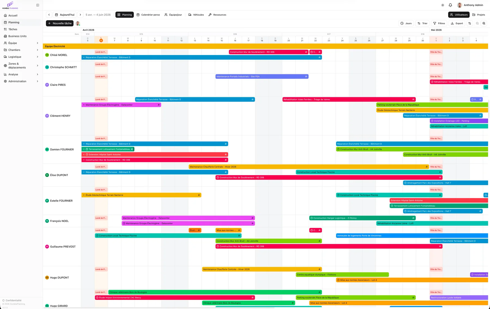
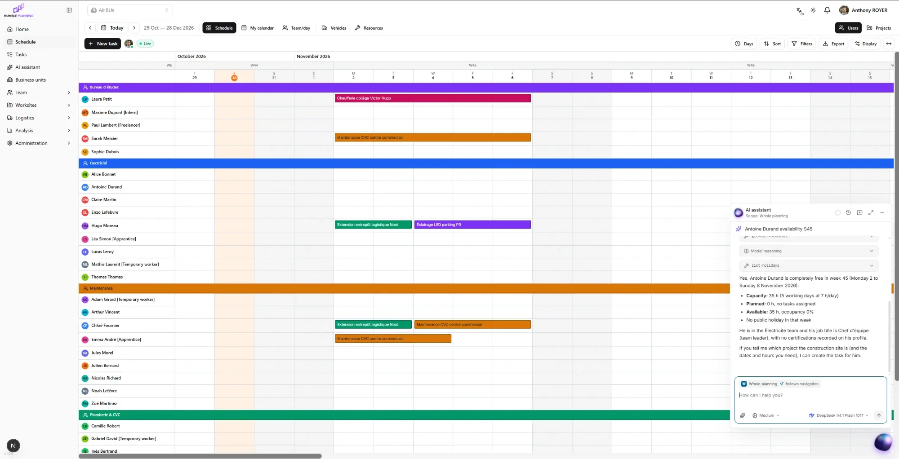
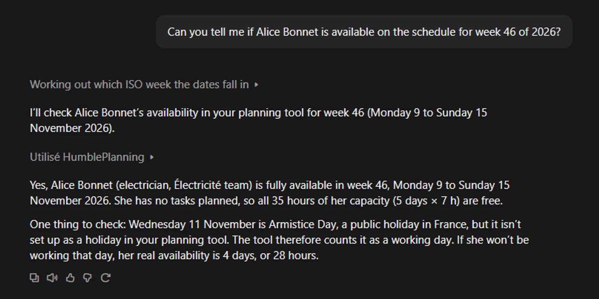
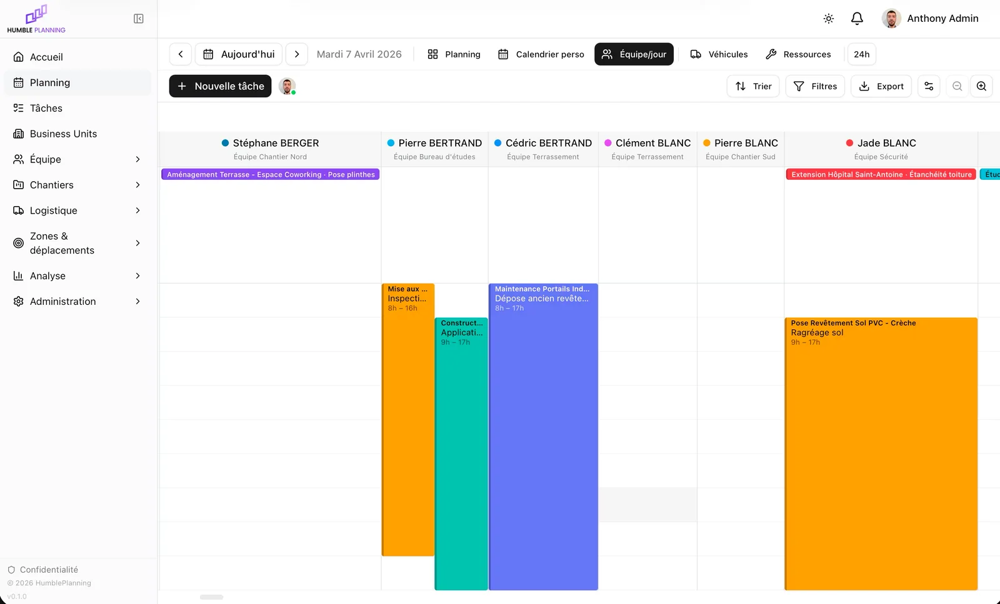
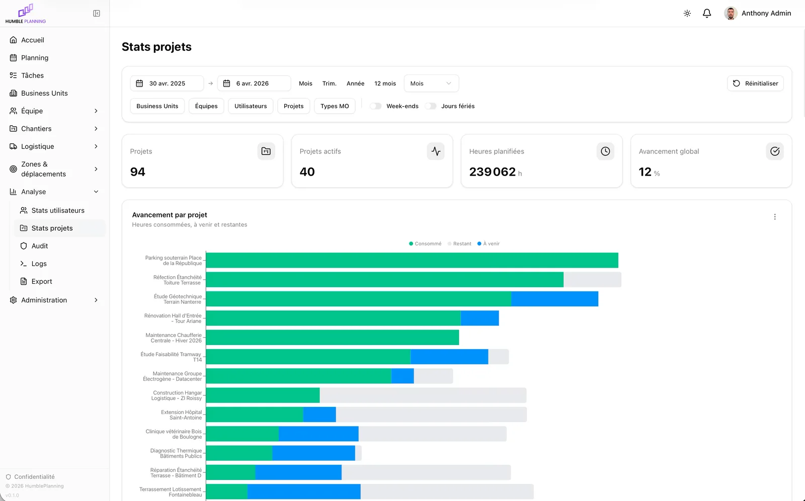
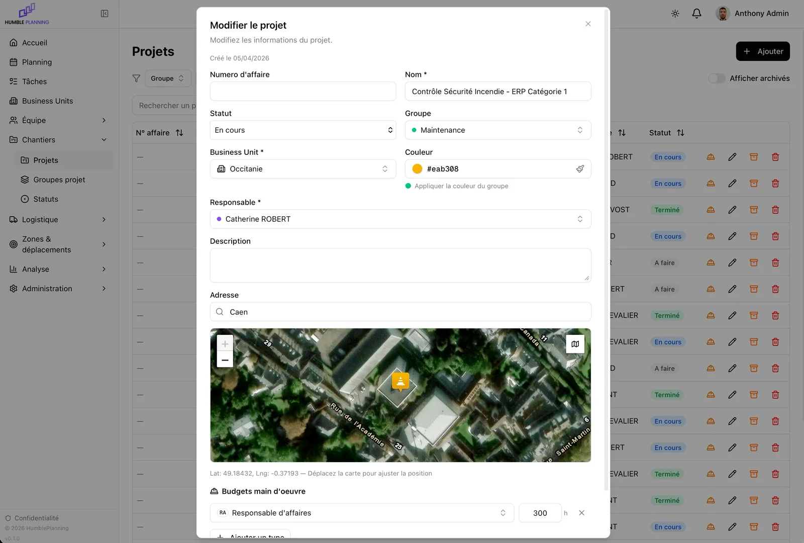
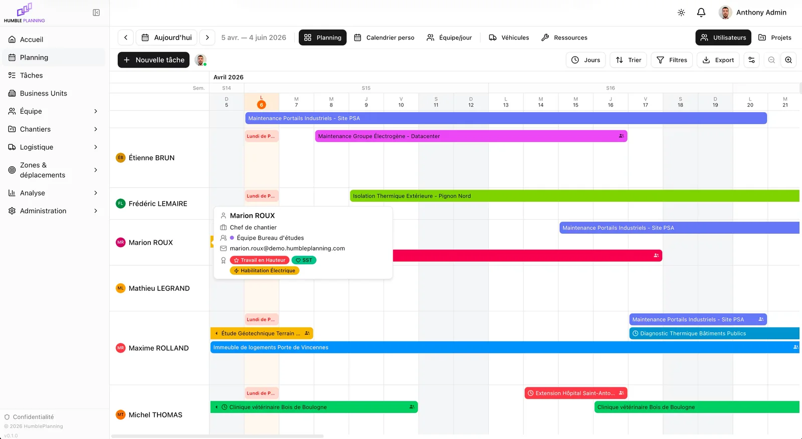
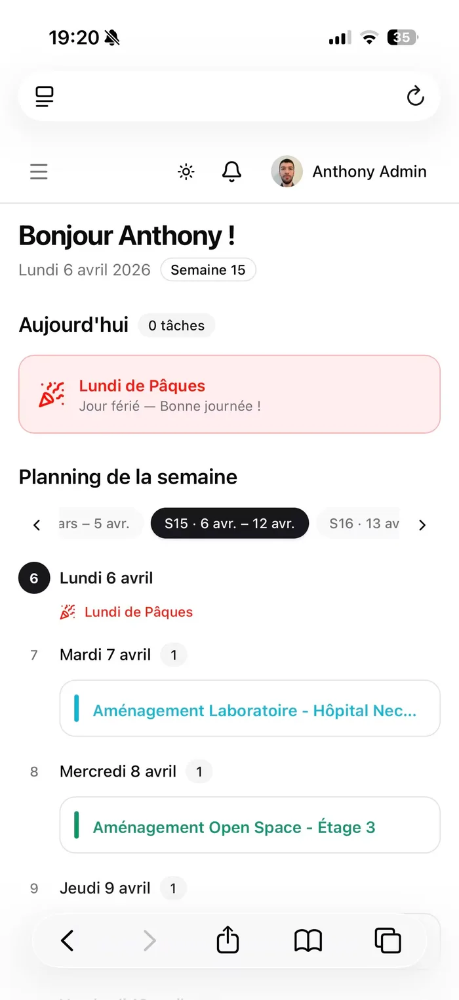

<p align="center">
  <a href="https://humbleplanning.com/">
    <picture>
      <source media="(prefers-color-scheme: dark)" srcset="public/branding-defaults/logo-dark.svg">
      
    </picture>
  </a>
</p>

<h3 align="center">Plan smarter, perform sustainably.</h3>

<p align="center">
  Open-source scheduling for field teams: people, vehicles and equipment on one real-time schedule,<br>
  with an AI assistant that works under your control.
</p>

<p align="center">
  <a href="https://humbleplanning.com/"><strong>Website</strong></a> ·
  <a href="http://demo.humbleplanning.app/"><strong>Live demo</strong></a> ·
  <a href="#quick-start"><strong>Quick start</strong></a> ·
  <a href="docs/installation.md"><strong>Installation guide</strong></a> ·
  <a href="CHANGELOG.md"><strong>Changelog</strong></a>
</p>

<p align="center">
  <a href="LICENSE"></a>
  <a href="CHANGELOG.md"></a>
  
  
  
  
  
</p>

<p align="center"><sub>A project by <a href="https://indumia.com/"><strong>Indumia</strong></a></sub></p>

---

<p align="center">
  <a href="#a-quick-tour">Tour</a> ·
  <a href="#why-humble-planning">Why</a> ·
  <a href="#features">Features</a> ·
  <a href="#ai-assistant-and-mcp-server">AI &amp; MCP</a> ·
  <a href="#live-demo">Demo</a> ·
  <a href="#quick-start">Quick start</a> ·
  <a href="#development">Development</a> ·
  <a href="#contributing">Contributing</a> ·
  <a href="#license">License</a>
</p>

## A quick tour

[](docs/screenshots/schedule.webp)

**The schedule.** Every team member on one grid, week after week: drag tasks to move them, stretch them to change their dates, see public holidays, multi-person assignments and recurring work at a glance. Everyone sees the same schedule, updated live.

[](docs/screenshots/ai-assistant.webp)

**The AI assistant.** Ask in plain language ("Is Antoine available in week 45?") and get an answer built from the live schedule: capacity, planned hours, holidays. It can also prepare changes, which are only applied once you approve them.

[](docs/screenshots/mcp-claude.webp)

**Or from the AI you already use.** Connect Claude, ChatGPT or any MCP client to Humble Planning as a custom connector. Here, Claude checks a person's availability for a whole week through the MCP server, with the user's own permissions, and even notices a public holiday that is missing from the schedule.

<table>
  <tr>
    <td width="50%" valign="top">
      <a href="docs/screenshots/team-day.webp"></a>
      <p><strong>Team/day view.</strong> Who does what, hour by hour, for a whole team on a given day.</p>
    </td>
    <td width="50%" valign="top">
      <a href="docs/screenshots/project-statistics.webp"></a>
      <p><strong>Project statistics.</strong> Consumed, upcoming and remaining hours for every project, against its budget.</p>
    </td>
  </tr>
  <tr>
    <td width="50%" valign="top">
      <a href="docs/screenshots/project-editor.webp"></a>
      <p><strong>Projects and worksites.</strong> Job numbers, groups, statuses, labour budgets and the site address on a satellite map.</p>
    </td>
    <td width="50%" valign="top">
      <a href="docs/screenshots/schedule-details.webp"></a>
      <p><strong>Details on hover.</strong> Job title, team, contact and qualifications without leaving the schedule.</p>
    </td>
  </tr>
</table>

<table>
  <tr>
    <td width="34%" valign="top">
      <a href="docs/screenshots/mobile.webp"></a>
    </td>
    <td valign="top">
      <h3>On the phone, in the field</h3>
      <p>The whole application is responsive. On a phone, each person opens on their own week: today's tasks, public holidays and the days ahead. Schedules can also be subscribed to from any calendar app (iCal), so the week shows up next to personal appointments.</p>
      <p>Notifications follow the team wherever they are: in-app, e-mail, push, and SMS or WhatsApp if enabled.</p>
      <p><sub>The screenshots show the interface in French and English. Humble Planning is available in English, French, Spanish and German: each user picks their language, and e-mails and exports follow it.</sub></p>
    </td>
  </tr>
</table>

## Why Humble Planning

- **As simple as a spreadsheet, far more powerful.** A grid everybody understands, with drag and drop, colours and filters, backed by a real database instead of a shared file.
- **Real time, for everyone.** Changes appear instantly on every screen, with live presence: no more outdated copies of the schedule.
- **Built for field operations.** Business units, teams, qualifications, labour types, contract types, vehicles, equipment and worksites with their addresses: the things construction, maintenance and service companies actually plan.
- **AI under control.** The assistant only sees what the user is allowed to see, never writes without explicit approval, and runs on the model you choose, with spending caps and privacy options.
- **Open and self-hosted.** Your server, your data, no licence fees. Install it with one command, brand it with your own logo and colours, extend it under the AGPL.
- **Secure by default.** Argon2id passwords, two-factor authentication, fine-grained roles and permissions, a full audit trail with restore, encrypted backups and GDPR tools.

## Features

| Area | Highlights |
| --- | --- |
| **Schedule** | Day and hour views; views by people, projects, vehicles and resources, plus a team/day view and a personal calendar; drag and drop, resize and copy; multi-person tasks, recurring tasks, milestones, half days; public holidays; filters, sorting and zoom; live presence |
| **Tasks** | Task list with search and filters, statuses, notes, attachments, locking and change history |
| **People** | Users, teams, business units, qualifications, labour types, contract types (employee, temporary worker, subcontractor, apprentice, intern, freelancer), job titles, hourly rates |
| **Projects and worksites** | Job numbers, project groups, custom statuses and colours, site address on a map, labour budgets in hours and cost, archiving |
| **Logistics** | Vehicles and resources with their types, assignments and availability on the schedule |
| **Analytics** | User statistics (workload, occupancy, hours by labour type), project statistics (consumed, upcoming and remaining hours), ROI |
| **Exports and calendars** | PDF (schedule grid or list, with optional statistics pages), Excel and CSV exports; personal iCal feeds |
| **Notifications** | In-app notifications, e-mail (SMTP, Mailgun or Nuntly), weekly summary e-mails, push notifications, SMS and WhatsApp (Sent.dm) |
| **AI assistant** | Full-page chat and floating assistant, answers from live data, approval card before any change, model of your choice through OpenRouter, monthly quota per user, local voice dictation, PDF and image attachments |
| **MCP server** | 40 tools for Claude, ChatGPT, Copilot and any MCP client, OAuth 2.1 with a consent screen or API keys, the user's own permissions on every call |
| **Security** | Argon2id, TOTP two-factor authentication with backup codes, password policy, brute-force protection, captcha (ALTCHA, Cloudflare Turnstile, reCAPTCHA), session management, audit trail with restore |
| **Administration** | Roles and permissions with scopes, white-label branding (logo, favicon, sign-in background for light and dark themes), announcement banner, working hours, date and time formats, time zone, maintenance mode, module switches, logs and purge tools |
| **Data** | Encrypted backups and restore, import from SoPlanning 1.56 and 1.57, REST API with API keys and built-in documentation |
| **Languages** | English, French, Spanish and German, per user, with e-mails, notifications and exports in each recipient's language |

## AI assistant and MCP server

Humble Planning ships with two ways to work with AI, both bound to the signed-in user's permissions.

**The built-in assistant** answers questions about the schedule ("Who is free next Tuesday in the electrical team?", "How many hours are planned on job B00102 this month?") and can prepare changes: create, move, copy, update or delete a task, create a project. Nothing is written until the user approves the change in a confirmation card that spells it out. Administrators choose the models (DeepSeek, Mistral, Claude, GPT and more through [OpenRouter](https://openrouter.ai/)), can require providers that keep no data, and set a monthly spending cap per user. Voice dictation runs locally in the browser with Whisper.

To enable it: *Settings → AI → AI chat*, enter an OpenRouter API key (or set `OPENROUTER_API_KEY` in `.env`) and add a model. The assistant switches on by itself; access is then granted per role ("Use the AI assistant", "Allow changes by the AI assistant").

**The MCP server** lets external assistants work with the schedule. Add a custom connector with the URL `https://<your-domain>/api/mcp` in Claude, ChatGPT or any MCP client: the user signs in to Humble Planning and approves the connection (OAuth 2.1), or uses a personal API key. Write tools require a dedicated permission. Setup guides for each client are in *Settings → AI → MCP*. See it in action in the [tour](#a-quick-tour).

## Live demo

Try Humble Planning at **[demo.humbleplanning.app](http://demo.humbleplanning.app/)**.

Demo sign-in details will be published here soon. The demo data is reset every night.

To run your own public demo, see [Demo instance](docs/installation.md#demo-instance).

## Quick start

Humble Planning runs with Docker. On a server running Ubuntu 22.04/24.04 LTS or Debian 12/13 (amd64 or arm64), run as root:

```bash
curl -fsSL https://raw.githubusercontent.com/Malfhas/HumblePlanning/main/install.sh | sudo bash
```

The installer:

- installs Docker Engine and Docker Compose when needed;
- asks for the public URL, the installation directory, the database (built-in PostgreSQL 18 or an existing server), and whether to set up Caddy for automatic HTTPS (Let's Encrypt, optionally through the Cloudflare DNS challenge);
- generates the secrets, applies the database migrations, creates the administrator account and starts the stack.

Then manage the installation with the `humble-planning` command:

```bash
humble-planning status        # version, available update, state of the containers
humble-planning logs app      # logs of the app, socket, db or caddy service
humble-planning update        # back up the database, update, roll back automatically on failure
humble-planning backup        # back up the database
humble-planning help          # every command
```

Non-interactive installation, updates and rollbacks, automatic updates, running behind an existing reverse proxy and building the Docker images yourself are covered in the **[installation guide](docs/installation.md)**.

## Development

Requirements: Bun 1.4.4 or later, Node.js 24 or later (26 recommended, see `.nvmrc`) and PostgreSQL 16 or later.

```bash
bun install
cp .env.example .env     # set DATABASE_URL, BETTER_AUTH_URL, APP_BASE_URL and the secrets
bun run db:migrate
bun run db:seed          # system roles, default statuses and a development administrator (admin / admin)
bun run dev              # application on http://localhost:3000
bun run dev:socket       # real-time server (Socket.io), in a second terminal
```

Built with [Next.js](https://nextjs.org/) 16, React 19, TypeScript, [Bun](https://bun.sh/), PostgreSQL with [Drizzle ORM](https://orm.drizzle.team/), [Better Auth](https://www.better-auth.com/), [Socket.io](https://socket.io/), Tailwind CSS 4, shadcn/ui and [next-intl](https://next-intl.dev/). The schedule grid is a custom canvas renderer.

## Contributing

Bug reports, ideas, translations and pull requests are welcome. Read [CONTRIBUTING.md](CONTRIBUTING.md) to set up the project and learn what is checked before a change is merged. Commits are signed off under the [Developer Certificate of Origin](DCO) (`git commit -s`): you keep the copyright of your contribution. Questions and ideas go to [Discussions](https://github.com/Malfhas/HumblePlanning/discussions). Everyone taking part follows the [Code of Conduct](CODE_OF_CONDUCT.md).

## Security

Please do not report security vulnerabilities in public issues. Use GitHub's [private vulnerability reporting](https://github.com/Malfhas/HumblePlanning/security/advisories/new) instead, as described in the [security policy](SECURITY.md).

## AI-assisted development

Humble Planning is developed with the help of AI coding assistants. They are tools in the hands of the maintainer: the product decisions, the architecture and the review of every change remain human, and all code goes through the same checks (type checking, automated tests, linting, translation checks) before it is merged. AI-assisted contributions are welcome under the same rules: see [CONTRIBUTING.md](CONTRIBUTING.md#ai-assisted-contributions).

## License

Humble Planning is free software, distributed under the **GNU Affero General Public License v3.0 or later** (`AGPL-3.0-or-later`). The full text is in the [LICENSE](LICENSE) file.

In short: you may use, study, modify and redistribute this software, including within a company. If you modify it and make it available to users over a network (for example as an online service), you must give them access to the source code of your modified version, under the same license.

## Credits

- Humble Planning is designed, built and maintained by **[Indumia](https://indumia.com/)**. Learn more at [humbleplanning.com](https://humbleplanning.com/).
- AI model icons come from [lobe-icons](https://github.com/lobehub/lobe-icons) (MIT, see `public/modeles/LICENCE.txt`).
